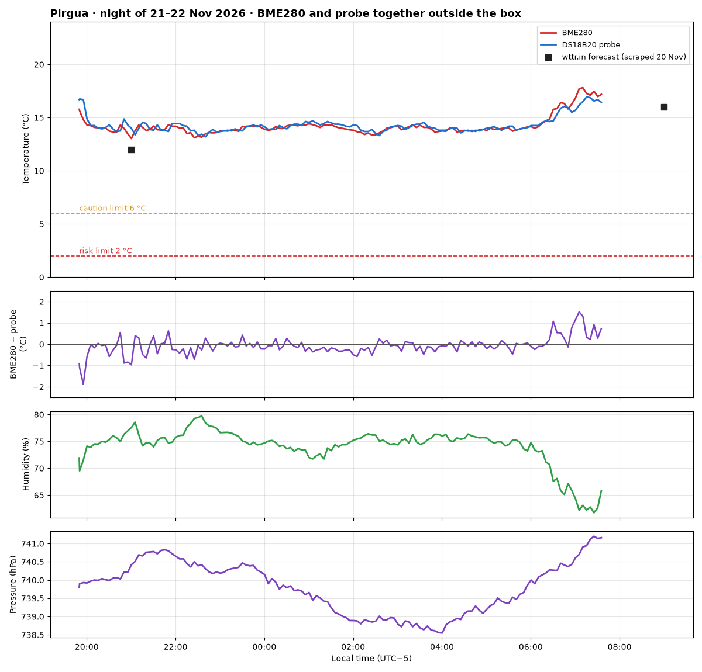
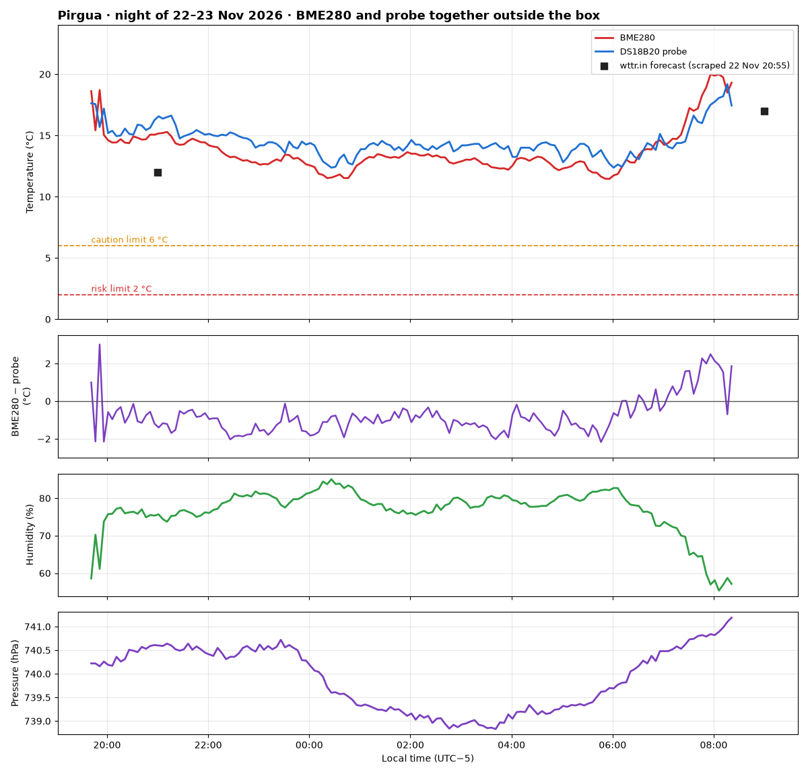

# Data capture protocol (own dataset, R4)

Status: **draft**. One outdoor night has been recorded (2026-11-20/21), but
it is not part of the dataset because of a sensor placement error (see
"Lessons from the first night"). The second and third nights (2026-11-21/22
and 22/23), with both sensors outside, are valid: 296 readings in total,
minimum 12.4 °C, so only class 0. There are no cold nights in the dataset yet.

## Where and how the node is installed

| Parameter | Value |
|---|---|
| Place | Vereda Pirgua, Tunja, at the author's home. Wall socket and home Wi-Fi available (confirmed) |
| Sensor height | 1.5 m above the ground |
| Sensor placement | **BME280 and DS18B20 outside the electronics box**, together inside the sun shield, open at the bottom, 20 to 30 cm from the box (I2C wires extended with jumpers; very long I2C wires stop working) |
| Electronics | ESP32-S3, breadboard and INA219 in a closed plastic box with silica gel; wires enter from below with a drip loop |
| Sun protection | Shield around the sensors (white cup or PVC tube with slots), so they measure air temperature and not direct sun |
| Site | Over grass or soil, away from walls, roofs, trees and concrete, which keep heat at night |
| Period | November to February, the season with most frost in the public data |
| Power | Wall charger; power bank as backup |
| Clock | NTP over the home Wi-Fi at every boot (`USE_WIFI_NTP 1`) |

## Lessons from the first night (2026-11-20/21)

The node worked without a PC for about 14 hours: 170 readings, all `ok`,
one every 5 minutes, clock set by NTP, no restarts. But the **BME280 was
inside the electronics box** and only the probe was outside:

- At night the BME280 read about 4.4 °C more than the probe (standard
  deviation 0.4 °C) and stayed almost flat, while the probe went down to
  12.5 °C at 06:14. In the indoor test, with both sensors in the same air,
  the difference had been +0.09 °C.
- The BME280 read about 60 % humidity. With its own dew point, the outdoor
  air at the probe temperature would have had about 80 %.
- The pressure is valid (it does not depend on the air around the sensor).

Rule: the BME280 must measure outdoor air, never the air of the box. The
log is kept as a test in `data/raw/node_tests/` and the chart is
[first_night_pirgua_2026-11-20.png](first_night_pirgua_2026-11-20.png).

## What is recorded

| Parameter | Value |
|---|---|
| Sensor | BME280 over I2C: temperature (°C), relative humidity (%), pressure (hPa, absolute station pressure) |
| Sampling interval | Every 5 minutes (`SAMPLE_INTERVAL_MINUTES` in the firmware `config.h`). Starting value, configurable |
| Sensor mode | Forced mode, oversampling x1, filter off: the sensor sleeps between readings to avoid self-heating |
| Timestamp | Local time (UTC-5) written with its offset, for example `2026-11-12T21:30:00-05:00` |
| Stored row | `timestamp_iso,temperature_c,humidity_pct,pressure_hpa,reference_temperature_c,status` in `/log.csv` (flash memory, LittleFS) |
| Reference probe | DS18B20 on GPIO4, read at every reading into `reference_temperature_c` (`nan` if absent). Only for calibration: the model does not use it |
| Invalid readings | NaN or outside the BME280 datasheet range (-40 to 85 °C, 0 to 100 %, 300 to 1100 hPa) are stored with status `sensor_error` and excluded later |

## Clock

The ESP32-S3 has no battery-backed clock: the time is lost on every reset or
power cut, and readings are not stored until the clock is set again.

- With Wi-Fi at the site: `USE_WIFI_NTP 1`, the clock is set at every boot.
- Without Wi-Fi: the clock is set from the PC (`SETTIME`, sent automatically
  by `ml/serial_dump.py`). After a power cut the node stops storing until
  someone connects a PC.

Which of the two will be used is to confirm.

## Calibration (in place, during the capture)

Decision of 2026-11-21: there is no separate calibration before the
capture. The BME280 and the DS18B20 probe are installed together in the sun
shield, so every reading of the capture also compares the two sensors.

1. After a night of capture, compute the offset with
   `python ml/calibration_report.py` (offset = BME280 minus probe: mean,
   standard deviation, minimum and maximum). `--start` and `--end` keep
   only some hours, for example the night.
2. Write the result here and, if a correction is decided, put the mean offset
   in `calibration.node_temperature_offset_c` of `ml/config.yaml`.
   `prepare_dataset.py` then subtracts it from the node temperature. The raw
   files are never changed. Only the temperature is corrected; the humidity
   is used as measured.

Limitation: the probe itself is not checked against a known temperature;
the offset says how much the two sensors differ, not which one is right.

Result of the second night (2026-11-21 19:49 to 2026-11-22 07:35, both
sensors together outside the box, 143 readings): BME280 minus probe is
**-0.12 °C** (standard deviation 0.25 °C) from 21:00 to 05:30. It is larger
when the sensors adapt to the outdoor air (first 40 minutes: -0.53 °C) and
at sunrise (06:00 to 07:36: +0.46 °C, peaks of +1.5 °C), probably because the
sun reaches one sensor before the other. Use only the night hours to decide a
correction. No correction is applied yet
(`calibration.node_temperature_offset_c` is `null`); one more night is
needed before deciding.

Result of the third night (2026-11-22 19:41 to 2026-11-23 08:21, 153
readings, the scraper ran all night): BME280 minus probe is **-1.16 °C**
(standard deviation 0.46 °C) from 21:00 to 05:00, against -0.12 °C on the
second night, with the same sensors. The offset is therefore **not constant**
and no correction is applied. Possible causes, not checked: a different
position of the sensors inside the shield, a wet BME280 (humidity reached
85 % and the air was 2.4 °C above its dew point), or an error of either
sensor. Which sensor is right was not determined.

Forecast on the nights measured: wttr.in gave 12 °C at 21:00 both nights,
while the probe read 14 and 15 to 16 °C. Only two cases, but the forecast
seems to underestimate at night.

Data periods: only the periods listed in `node.valid_periods` of
`ml/config.yaml` enter the dataset (see `data/raw/node/README.md`).

## From the node to the dataset

1. Download the log: `python ml/serial_dump.py COM9` creates
   `data/raw/node/node_log_<date>_<time>.csv`. Raw files are never edited or
   deleted. Downloading does not erase the node; `CLEAR` is sent by hand
   after checking the file.
2. Build a version: `python ml/prepare_dataset.py` creates
   `data/processed/dataset_vN.csv` with its report and a copy of the
   configuration used.

## Labeling

The class of each window depends on the minimum air temperature of the
following 6 hours. Decided on 2026-11-21 (the author asked to choose the most
convenient option); written in `ml/config.yaml`:

| Class | Name | Minimum of the next 6 h |
|---|---|---|
| 2 | risk | at or below 2 °C |
| 1 | caution | above 2 °C and at or below 6 °C |
| 0 | no risk | above 6 °C |

- **2 °C:** the sensors are at 1.5 m. On clear, calm nights the crop surface
  can be several degrees colder than the air at that height (FAO, *Frost
  Protection: Fundamentals, Practice and Economics*, 2005), so 2 °C in the
  air is treated as possible frost on the crop.
- **6 °C:** an operational caution band, **not an agronomic value**. Nights at
  or below 2 °C are rare (IDEAM UPTC Tunja: 9 days in 2019-2026), so the band
  gives the model examples of cold nights.
- **Minimum per class:** at least 10 station-days of each class in the
  training split (`min_days_per_class_train`); `prepare_dataset.py` warns if
  a class has fewer.
- If an agronomic source (Fedepapa, ICA) gives other values, change them in
  the config and build a new dataset version.

## Versions and split

- Versions `v1`, `v2`, ...: a new one every time the dataset is extended or
  corrected (`dataset_version` in `ml/config.yaml`). A version is never
  overwritten.
- Split into train, validation and test by **whole calendar days**
  (70 / 15 / 15 %), with a fixed seed. Every reading of a day is in the same
  split, and a day is in the same split for every source, so there is no
  leakage between splits.
- **Stratified:** days are grouped by the highest class of any of their
  windows, and each group is split 70 / 15 / 15 on its own, so the rare cold
  days reach validation and test too. Both rules are checked by
  `tests/test_prepare_dataset.py`.
- Known limitation: a window close to midnight uses a few hours of the
  neighbouring day.

## Public data

The IDEAM series of the UPTC Tunja station and the Zenodo Altiplano dataset
are support data only: they were used to develop and test the code. The
final results must come from a model trained and evaluated with data from
the node. Set `training.sources: [node]` in `ml/config.yaml` to train only
with the own data.

## Ethics

No personal data is collected. Installing the node needs the permission of
the owner of the land.
